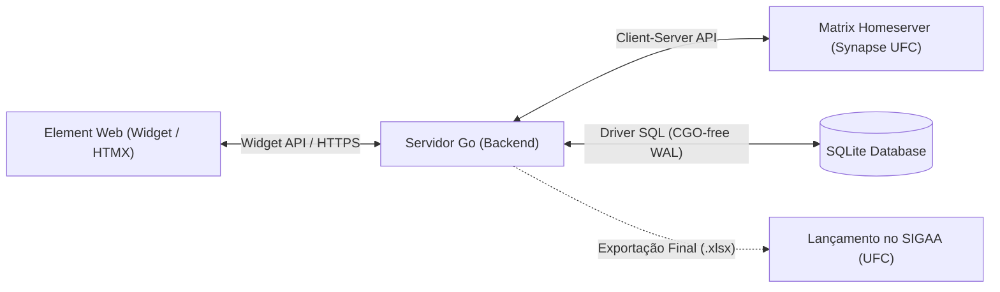

# Proposta de projeto: Frequência Matrix Integration & Widget

Proposta de tema para a disciplina de Sistemas Distribuídos (UFC / `matrix.dc.ufc.br`).

## 1. Ideia

Na UFC, o registro oficial de presença dos alunos fica no SIGAA. Fazer a chamada direto por lá durante a aula costuma atrapalhar: o sistema fica lento ou fora do ar, e o fluxo burocrático interrompe o andamento da turma.

A proposta separa a chamada do dia a dia do lançamento institucional. Durante a aula, o professor registra a frequência em segundos por um widget integrado ao Element Web, marcando apenas quem faltou (registro por exceção). O controle de acesso usa o próprio protocolo Matrix, por nível de poder (>= 50) ou PIN. Os alunos acompanham os avisos de chamada e a própria frequência na sala, e no fim do semestre o sistema exporta uma planilha `.xlsx` com totais de faltas, percentuais e situação de aprovação, pronta para o lançamento no SIGAA.

## 2. Objetivo

Desenvolver um sistema distribuído leve, formado por um backend em Go e um widget para Element Web, para gerenciar a frequência das aulas ao longo do semestre no Matrix e consolidar os dados em um formato compatível com o SIGAA.

### Objetivos específicos

- Registrar presenças em tempo real (aulas presenciais ou remotas) marcando apenas os faltosos, com suporte a turmas mistas de Graduação e Pós-Graduação.
- Validar a permissão do professor pelo estado da sala (`m.room.power_levels`) e por OpenID, sem exigir novos cadastros ou bancos de senhas.
- Publicar avisos oficiais imutáveis na timeline da sala (`m.notice`) a cada chamada realizada.
- Acompanhar o limite de 25% de faltas ao longo do semestre e exportar uma planilha `.xlsx` estruturada para o lançamento no SIGAA ao término do período letivo.

## 3. Arquitetura inicial e componentes

O sistema conecta o widget no Matrix a um servidor em Go com banco local e gera a planilha para o fechamento acadêmico:

### Componentes do sistema

1. Widget frontend (Element Web): interface web responsiva feita com Go Templates, HTMX e Tailwind CSS, embutida via Matrix Widget API para uso rápido no celular ou no computador em sala de aula.
2. Servidor de aplicação (backend em Go): binário estático em Go (`scratch`) com as regras de frequência, cálculo do calendário letivo, importação de turmas via CSV e geração da planilha `.xlsx` para o SIGAA.
3. Gateway Matrix (`mautrix`): módulo que se comunica com o homeserver da UFC para autenticar identidades via OpenID, checar privilégios (`m.room.power_levels`) e enviar eventos (`m.notice`).
4. Camada de persistência (SQLite WAL): banco local em arquivo único com modo WAL ativado, sem depender de SGBDs externos, facilitando a execução autocontida e a replicação simples.
