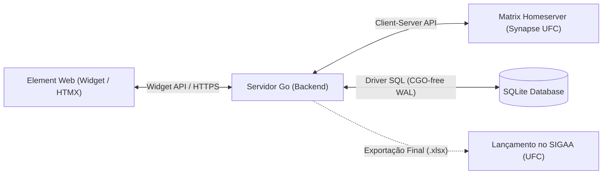

# Proposta de Projeto: Frequência Matrix Integration & Widget

Documento de proposição de tema para a disciplina de **Sistemas Distribuídos** (UFC / `matrix.dc.ufc.br`).

---

## 1. Ideia

Na UFC, o registro institucional de presença dos alunos é centralizado no **SIGAA**. No entanto, realizar a chamada diretamente pelo SIGAA durante a aula apresenta fricções recorrentes: lentidão, sistema fora do ar e um fluxo burocrático que interrompe a dinâmica didática.

A **ideia** do projeto é desacoplar o registro operacional da burocracia institucional:

- **Operação Ágil no Matrix:** O professor realiza a chamada durante a aula em segundos por meio de um **Widget integrado no Element Web**, marcando apenas as faltas (registro por exceção) com controle de acesso nativo pelo protocolo Matrix (níveis de poder >= 50 ou via PIN).
- **Transparência e Fechamento para o SIGAA:** Os alunos acompanham sua frequência e avisos de chamada na própria sala, e, ao final do semestre, o sistema gera a exportação consolidada (`.xlsx`) com os totais de faltas, percentuais e status de aprovação prontos para lançamento no SIGAA.

---

## 2. Objetivo

Desenvolver um sistema distribuído leve composto por backend em Go e widget para Element Web para gerenciar a frequência contínua de aulas ao longo do semestre no Matrix, consolidando os dados para exportação final compatível com o SIGAA.

### Objetivos Específicos

- **Chamada em Tempo Real (Presencial/Remota):** Permitir registro ágil de presenças marcando apenas os faltosos, com suporte a turmas mistas (Graduação e Pós-Graduação).
- **Autorização Baseada no Protocolo:** Validar permissão de docente via estado da sala (`m.room.power_levels`) e OpenID, dispensando novos cadastros ou bancos de senhas.
- **Auditoria e Transparência:** Emitir avisos oficiais imutáveis na timeline da sala (`m.notice`) a cada chamada realizada.
- **Fechamento e Exportação para o SIGAA:** Acompanhar o teto de 25% de faltas em tempo real e exportar planilha (.xlsx) estruturada para alimentação das notas e faltas no SIGAA ao término do período letivo.

---

## 3. Arquitetura Inicial e Componentes

O sistema atua como uma camada operacional ágil conectada ao ecossistema Matrix, preparando os dados para o fechamento acadêmico:

### Componentes do Sistema

1. **Widget Frontend (Element Web Layer):**
   - Interface web responsiva (Go Templates + HTMX + Tailwind CSS) embutida via Matrix Widget API, permitindo chamada rápida pelo celular ou computador em sala de aula.
2. **Servidor de Aplicação (Go Backend):**
   - Binário estático em Go (`scratch`) contendo as regras de negócio de frequência, cálculo do calendário letivo, importação de turmas (CSV) e motor de exportação `.xlsx` formatado para o SIGAA.
3. **Gateway Matrix (`mautrix`):**
   - Módulo de comunicação com o homeserver da UFC para autenticação de identidade (OpenID), checagem de privilégios (`m.room.power_levels`) e despacho de eventos (`m.notice`).
4. **Camada de Persistência (SQLite WAL):**
   - Armazenamento local leve em arquivo único com WAL ativado, sem dependência de SGBDs externos, ideal para execução autocontida e replicação simples.
