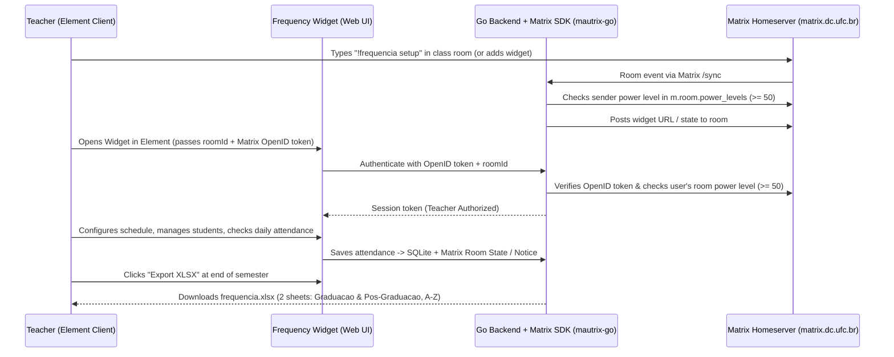

# Matrix Frequency Integration & Widget (`frequencia-matrix-integration`)

## Goal Description

Build a Matrix protocol integration and Element Web widget in **Go** (using [`mautrix-go`](https://github.com/mautrix/go)) for the *Sistemas Distribuídos* course (`matrix.dc.ufc.br`).

The integration enables the teacher of a class Matrix room to:
1. **Configure the course schedule** on initial setup (days of the week, e.g., Tue/Thu, and total number of class periods in the semester).
2. **Manage the student roster** (add or remove students at any time, specifying **Name** and category: **Graduation** or **Pos-Graduation**).
3. **Record daily attendance** during class via an interactive visual widget embedded in Element—calling out names and checking off presence for each class date.
4. **Restrict usage to the teacher** by inferring the user's role directly from Matrix room state (`m.room.power_levels` Admin/Moderator role, power level $\ge 50$).
5. **Export end-of-semester attendance** as an `.xlsx` spreadsheet with two separate tabs (`Graduacao` and `Pos-Graduacao`), sorted alphabetically by student name, with an easily adaptable column mapper.

---

## Architecture & How Teacher Role Inference Works



### How "Teacher-Only" by Room Role Works in Matrix
Every Matrix room has a built-in state event called `m.room.power_levels`:
- **Admin (Room Creator / Teacher)**: Power Level `100`
- **Moderator (Teacher / TA)**: Power Level `50`
- **Default Member (Students)**: Power Level `0`

When someone opens the widget in Element:
1. Element's `matrix-widget-api` requests an **OpenID token** from the user's Matrix client and sends it to our Go backend along with the `room_id`.
2. The Go backend exchanges that token with the Matrix homeserver (`matrix.dc.ufc.br`) to confirm the caller's exact Matrix ID (e.g., `@professor:matrix.dc.ufc.br`).
3. Using `mautrix-go`, the backend inspects `m.room.power_levels` for that `room_id`. If the user's power level is `< 50`, the backend returns `403 Forbidden` and the widget shows a read-only "Teacher Access Only" screen.
4. For local development/testing convenience, a fallback local dev token mode can also be toggled via environment variable.

---

## User Review Required

> [!IMPORTANT]
> **Storage Choice (SQLite + Matrix Room Events)**:
> The plan uses an embedded SQLite database (`modernc.org/sqlite`, pure Go with no CGO required) to store course configuration, students, and attendance records reliably, while using `mautrix-go` to verify room roles, handle `!frequencia` room commands, and post attendance summaries/state events to the Matrix room.

> [!NOTE]
> **Adaptable Export Schema**:
> The `.xlsx` exporter uses an isolated `ExportColumnConfig` struct so changing column headers, order, or attendance symbols (`P`/`F`, percentages, or SIGAA-specific fields) takes editing a single table definition.

---

## Proposed Changes

```
frequencia-matrix-integration/
├── cmd/
│   └── server/
│       └── main.go                  # Entrypoint: wires SQLite, mautrix-go client, and HTTP server
├── internal/
│   ├── domain/
│   │   ├── models.go                # Immutable structs: CourseConfig, Student, AttendanceSession, ExportRow
│   │   └── schedule.go              # Semester schedule calculator & alphabetical sorting/grouping logic
│   ├── store/
│   │   ├── sqlite.go                # SQLite repository implementation (WAL enabled)
│   │   ├── migrations.go            # Embedded SQL migration runner (//go:embed migrations/*.sql)
│   │   ├── migrations/
│   │   │   └── 001_initial.sql      # Initial DDL schema for courses, students, and attendance
│   │   └── sqlite_test.go           # Repository unit/integration tests
│   ├── matrix/
│   │   ├── gateway.go               # Thin interface over mautrix-go (role check, OpenID verify, room bot)
│   │   ├── mautrix_client.go        # Production mautrix-go implementation
│   │   └── fake_client.go           # Named fake Matrix client for fast unit & integration tests
│   ├── export/
│   │   ├── xlsx.go                  # Two-sheet XLSX generator (Graduacao & Pos-Graduacao, A-Z)
│   │   └── xlsx_test.go             # Verifies 2 sheets, alphabetical sorting, and column layout
│   └── web/
│       ├── handler.go               # HTTP handlers rendering Go html/template + HTMX partials
│       ├── handler_test.go          # HTTP & auth boundary tests (teacher vs student power level)
│       └── templates/
│           ├── layout.html          # Base layout loading HTMX + Tailwind CSS (no custom JS/CSS files)
│           ├── setup.html           # Course configuration partial (hx-post)
│           ├── roster.html          # Student list & add/remove partial (hx-post / hx-delete)
│           ├── attendance.html      # Daily roll-call checklist partial (hx-post)
│           └── summary.html         # Semester summary table & XLSX download button
├── Dockerfile                       # Multi-stage FROM scratch build (based on ArtroxGabriel/dockerfiles/go)
├── docker-compose.yml               # Local test environment (Conduit Matrix Server + Element Web + App)
├── go.mod
└── README.md                        # Setup & testing guide (local + matrix.dc.ufc.br)
```

---

### 1. Domain Layer (`internal/domain`)

#### [NEW] `internal/domain/models.go`
Defines strongly typed, immutable domain models and input validation at system boundaries:
- `StudentLevel`: `"GRADUATION"` | `"POS_GRADUATION"`
- `CourseConfig`: `RoomID`, `CourseName`, `Weekdays []time.Weekday`, `TotalPeriods int`, `StartDate string`
- `Student`: `ID`, `RoomID`, `FullName`, `RegistrationNumber` (optional *matrícula*), `Level StudentLevel`, `CreatedAt`
- `AttendanceRecord`: `RoomID`, `ClassDate string`, `PeriodCount int`, `PresentStudentIDs map[string]bool`

#### [NEW] `internal/domain/schedule.go`
Pure functions for:
- Generating suggested class dates based on `StartDate`, configured `Weekdays`, and `TotalPeriods`.
- Splitting students into `Graduation` and `Pos-Graduation` slices and sorting each slice alphabetically (case- and accent-insensitive).
- Computing attendance statistics (`Presences`, `Absences`, `AttendancePercent`) against configured `TotalPeriods`.

---

### 2. Persistence Layer (`internal/store`)

#### [NEW] `internal/store/sqlite.go`
Pure-Go SQLite store (`modernc.org/sqlite`, `CGO_ENABLED=0` compatible) with **WAL mode** enabled on connection initialization:
- Connection & concurrency pragmas applied automatically on startup:
  ```sql
  PRAGMA journal_mode = WAL;
  PRAGMA synchronous = NORMAL;
  PRAGMA foreign_keys = ON;
  PRAGMA busy_timeout = 5000;
  ```

#### [NEW] `internal/store/migrations.go` & `internal/store/migrations/001_initial.sql`
Uses `//go:embed migrations/*.sql` so SQL DDL files live in clean, versioned `.sql` files while still compiling into the single `FROM scratch` binary:
- `schema_migrations` tracking table
- `courses` table (`room_id`, `course_name`, `weekdays_json`, `total_periods`, `start_date`)
- `students` table (`id`, `room_id`, `full_name`, `registration_number`, `level`, `active`)
- `attendance_sessions` & `attendance_entries` tables (`room_id`, `class_date`, `periods`, `student_id`, `is_present`)

---

### 3. Matrix Protocol Integration (`internal/matrix`)

#### [NEW] `internal/matrix/gateway.go`
Defines the `MatrixGateway` interface injected into the HTTP handlers and bot service:
```go
type MatrixGateway interface {
    VerifyWidgetUser(ctx context.Context, roomID string, openIDToken string) (UserIdentity, error)
    IsRoomTeacher(ctx context.Context, roomID string, userID string) (bool, error)
    SendAttendanceSummary(ctx context.Context, roomID string, classDate string, presentCount int, totalCount int) error
}
```

#### [NEW] `internal/matrix/mautrix_client.go`
Implements `MatrixGateway` using `maunium.net/go/mautrix`:
- Connects to `MATRIX_HOMESERVER_URL` (e.g., `https://matrix.dc.ufc.br`) with bot/integration credentials.
- Listens for `!frequencia` in a room: if the sender has power level $\ge 50$, replies with the widget setup link / installs the `im.vector.modular.widgets` state event if permitted.
- Implements `IsRoomTeacher` by fetching `m.room.power_levels` for `roomID` and checking `PowerLevels.GetUserLevel(userID) >= 50`.

---

### 4. Spreadsheet Exporter (`internal/export`)

#### [NEW] `internal/export/xlsx.go`
Uses `github.com/xuri/excelize/v2` to build a two-sheet `.xlsx` file:
- **Sheet 1**: `Graduacao` (sorted A–Z by `FullName`)
- **Sheet 2**: `Pos-Graduacao` (sorted A–Z by `FullName`)
- **Adaptable Columns**:
  1. `#` (Row number)
  2. `Nome` (Student Name)
  3. `Matricula` (Optional Registration ID)
  4. Dynamic columns for each recorded class date (`DD/MM` -> `P` or `F`)
  5. `Presencas` (Total present periods)
  6. `Faltas` (Total absent periods)
  7. `% Frequencia` (Percentage based on `TotalPeriods`)
  8. `Situacao` (`Aprovado por Frequência` $\ge 75\%$ vs `Reprovado por Falta`)

---

### 5. Element Widget UI & HTTP Handlers (`internal/web`)

#### [NEW] `internal/web/handler.go` & `internal/web/templates/*.html`
Server-rendered UI using **Go `html/template` + HTMX + Tailwind CSS** (embedded via `//go:embed templates/*.html`, eliminating custom `app.js` and `styles.css` files):
- Element natively substitutes `$matrix_room_id` and `$matrix_user_id` into widget URLs (e.g., `https://.../widget?roomId=$matrix_room_id&userId=$matrix_user_id`), and our Go handler verifies the teacher's room role on every request.
- **HTMX Partials (`templates/*.html`)**:
  1. **`setup.html` (Course Setup Tab)**: Select days of week (Mon–Sat), total periods in semester (e.g., `64` or `32` classes), and course title (`hx-post="/widget/setup"`).
  2. **`roster.html` (Roster Management Tab)**: Add student (`Name`, optional `Matrícula`, `Graduation` / `Pos-Graduation`) with `hx-post="/widget/students"` or remove with `hx-delete="/widget/students/{id}"`.
  3. **`attendance.html` (Daily Roll Call / Chamada Tab)**: Pick class date (defaults to today or next scheduled class day), see alphabetical checklist grouped by Graduation / Pos-Graduation, toggle presence while calling names, and click **Save Attendance** (`hx-post="/widget/attendance"`).
  4. **`summary.html` (Semester Summary & Export Tab)**: Live server-rendered table of attendance percentages and a direct **Download XLSX (2 Sheets)** link (`/widget/export.xlsx`).

---

### 6. Containerization (`Dockerfile` & `docker-compose.yml`)

#### [NEW] `Dockerfile`
Follows [`ArtroxGabriel/dockerfiles/go/Dockerfile`](https://raw.githubusercontent.com/ArtroxGabriel/dockerfiles/refs/heads/main/go/Dockerfile):
- Multi-stage build using `golang:${GO_VERSION}-alpine AS builder` with BuildKit cache and bind mounts (`--mount=type=cache`, `--mount=type=bind`).
- Static binary build with `CGO_ENABLED=0` and `-trimpath -ldflags '-s -w -extldflags "-static"'` (fully compatible with `modernc.org/sqlite`).
- `FROM scratch` runtime image running as non-root `USER 10001:10001` (`scratchuser`), with `/app/data` pre-owned by `10001:10001` so SQLite can create its `.db`, `.db-wal`, and `.db-shm` files cleanly.

---

## Verification Plan

### 1. Automated Unit & Integration Tests (Single Command)
All tests run with a single command with no external server or manual setup required:
```bash
go test -v -race -coverprofile=coverage.out ./... && go tool cover -func=coverage.out
```
- **Domain & Schedule Tests**: Verify weekday schedule generation, attendance percentage calculations, and alphabetical sorting across Graduation and Pos-Graduation groups.
- **SQLite Store Tests**: Verify course config upsert, adding/removing students mid-semester, and recording/updating daily attendance in an in-memory SQLite instance.
- **XLSX Export Tests**: Parse the generated `.xlsx` buffer with `excelize`, asserting that both `Graduacao` and `Pos-Graduacao` sheets exist, rows are strictly in alphabetical order, and totals match.
- **HTTP & Matrix Auth Tests**: Using `FakeMatrixClient`, verify that users with power level $\ge 50$ (teacher) can manage attendance and export sheets, while users with power level $0$ (students) receive `403 Forbidden`.

### 2. Local Interactive Verification (Browser / Element Widget)
1. **Standalone Preview Mode**: Run `DEV_MODE=true go run ./cmd/server` and open `http://localhost:8080/?roomId=!demo:matrix.dc.ufc.br` in a browser to test the widget UI, add students, take attendance, and download the `.xlsx` file directly.
2. **Local Matrix + Element Stack (`docker-compose.yml`)**: Run `docker compose up` to spin up a local Matrix homeserver + Element Web + the Go service, add the widget in a room with `/addwidget http://localhost:8080/?roomId=$matrix_room_id`, and verify teacher-only access and live room notifications.
3. **Live Test on `matrix.dc.ufc.br`**: Create a private test room on `matrix.dc.ufc.br`, run the Go server pointed at `https://matrix.dc.ufc.br`, and add the widget to the test room in Element.
